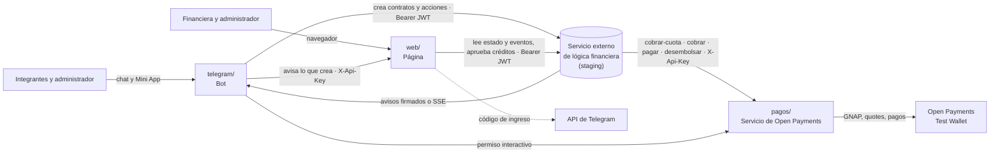

# Arquitectura de Natillera 2.0

La vista de todo el sistema: qué piezas hay, cómo se hablan, qué está construido hoy y qué decisiones se tomaron. Se mantiene al día con el código (`.claude/rules/documentacion.md`): si una pieza, un flujo o una decisión cambia, se corrige aquí en el mismo PR. El detalle de cada pieza está en el README de su carpeta.

Contrastado con el código el 16 de octubre de 2026 (`develop` en `02fb966`).

## Las piezas

| Pieza | Carpeta | Qué hace | Qué no hace |
|---|---|---|---|
| Bot de Telegram | [`telegram/`](../telegram/) | Todo lo del participante y el administrador: crear la natillera, invitar, unirse, autorizar el cobro, ver aportes, mora, actividades, pedir préstamo. Incluye la Mini App | No mueve dinero ni guarda el estado de la natillera (lo lee del servicio externo) |
| Página web | [`web/`](../web/) | La financiera y el administrador: natilleras, solicitudes de crédito, registro de pagos para el jurado y bitácora. Guarda la lista de natilleras, porque el servicio externo no lista | No mueve dinero; no aplica reglas de dinero (las muestra) |
| Servicio de pagos | [`pagos/`](../pagos/) | Lo único que habla con Open Payments: cobrar cuotas con un solo permiso, cobrar, pagar y desembolsar; guarda las cuatro etapas de cada pago para el jurado | No decide montos ni cuándo cobrar: eso lo pide el servicio externo. Lo escribe el equipo a mano |
| Servicio externo de lógica financiera | fuera del repo ([referencia](../integracion/README.md)) | Aplica las reglas de dinero: cupo y arranque, cuotas, mora, actividades, crédito y liquidación. Corre su reloj a las 06:00 | No es parte de la hackathon: el proyecto solo lo llama por API |
| Design system | [`design-system/`](../design-system/) | Marca, tokens, componentes y voz y tono; la web lo copia con `npm run ds` y el bot usa sus colores y textos | — |

## Las puertas a sistemas externos

Una sola puerta por sistema (`.claude/rules/codigo.md`). Si algo llama a un sistema externo desde otro sitio, está mal ubicado.

| Sistema | Quién lo llama | Desde dónde | Autenticación |
|---|---|---|---|
| Servicio externo (staging) | Web | `web/src/lib/servicio/` (`http.ts`, rutas provisionales) | Hoy `X-Api-Key` (`SERVICIO_URL`, `SERVICIO_API_KEY`); planeado `Bearer` (`SERVICIO_EXTERNO_URL`, `SERVICIO_EXTERNO_TOKEN`, `web/INTEGRACION.md`) |
| Servicio externo (staging) | Bot | _Por construir_: hoy `EXTERNO_URL` y `EXTERNO_API_KEY` solo se validan y se muestran en `/diag`; el enganche es `crearNatillera` en `telegram/src/bot/flujos/crear.js` | Planeado `Bearer` (`SERVICIO_EXTERNO_URL`, `SERVICIO_EXTERNO_TOKEN`, `telegram/INTEGRACION.md`) |
| Open Payments | Servicio de pagos | `pagos/` (#4) | Claves de la billetera, en `pagos/.env` |
| API de Telegram | Bot | grammY, en `telegram/src/` | `BOT_TOKEN` |
| API de Telegram | Web (solo para enviar el código de ingreso) | `web/src/lib/sesion/telegram.ts` | `TELEGRAM_BOT_TOKEN` (el mismo bot) |
| Índice de la web | Bot | _Por construir_ en los dos lados: la web aún no tiene `/api/indice/*` (`telegram/INTEGRACION.md`, sección 3) | `X-Api-Key` (`WEB_INDICE_API_KEY`) |

**Datos de prueba:** viven solo detrás de esas puertas y se ven como tales. La web usa los de `lib/servicio/mock.ts` mientras no haya `SERVICIO_URL` y el panel muestra un aviso; la Mini App «Mi natillera» usa `telegram/miniapp/natillera/datos-demo.js` y dice «Datos de ejemplo» hasta #5.

**Hoy, en resumen:** el bot y la web funcionan solos, con datos de prueba; ninguna pieza llama todavía a staging, a pagos ni a la otra. `pagos/` no tiene código. El único tráfico real es con la API de Telegram (el bot, y la web para enviar el código de ingreso).

## Los flujos

| # | Flujo | Recorrido | Estado hoy |
|---|---|---|---|
| 1 | Crear la natillera | Administrador → bot (chat o Mini App) → servicio externo (`natillera-cuenta`) → bot avisa a la web | El bot arma la natillera y muestra una vista previa; la creación en staging espera #5 |
| 2 | Unirse y autorizar el cobro | Participante → bot → servicio externo (`natillera-participacion`) → bot ↔ pagos (permiso interactivo en la billetera) → bot `ConfirmarAutorizacion` | Por construir (#17, #18, #19, #4) |
| 3 | Cobro de cada cuota | Reloj del servicio externo → `POST /cobrar-cuota` en pagos → Open Payments → aviso `CuotaPagada` → bot | Por construir (#4, #25). Es el pago que mira el jurado |
| 4 | Mora | Reloj → `RecordatorioMora` → bot → participante → `PagarDeuda` → `POST /cobrar` | Por construir (#27) |
| 5 | Crédito | Aviso `ElegibleParaPrestamo` → bot → solicitud a la web → financiera aprueba en `/creditos` → web crea `natillera-credito-ahorro` → `POST /desembolsar` | La pantalla de solicitudes existe con datos de prueba; la integración es #54 |
| 6 | Liquidación | Reloj `IniciarLiquidacion` → `POST /pagar` a cada participante → `NatilleraCerrada` | Por construir (#28) |
| 7 | Registro para el jurado | Pagos guarda las cuatro etapas → web `/pagos` las une con los eventos de staging | La pantalla existe con datos de prueba (US-007-RPT) |
| 8 | Ingreso a la web | Usuario → `/ingresar` → código de 6 dígitos por Telegram → cookie firmada con su rol | Construido (`web/src/lib/sesion/`) |

El ciclo completo en llamadas a staging está en [`integracion/README.md`](../integracion/README.md#el-ciclo-en-llamadas).

## Dónde vive cada contrato

| De → a | Contrato | Documento |
|---|---|---|
| Servicio externo → pagos | `/cobrar-cuota`, `/cobrar`, `/pagar`, `/desembolsar` | [`pagos/README.md`](../pagos/README.md) y `docs/discovery/4-logica-financiera/apis/open-payments.api.json` |
| Bot → pagos | Permiso interactivo y vuelta al bot | `pagos/README.md` (_por definir en #4_) |
| Bot y web → servicio externo | Contratos, acciones y lectura de estado | [`integracion/README.md`](../integracion/README.md), [`telegram/INTEGRACION.md`](../telegram/INTEGRACION.md), [`web/INTEGRACION.md`](../web/INTEGRACION.md) |
| Servicio externo → bot | Avisos | `telegram/INTEGRACION.md`, sección 2 |
| Bot → web | Índice de natilleras, participaciones, actividades y solicitudes | `telegram/INTEGRACION.md`, sección 3, y `web/INTEGRACION.md`, sección 1 |

## Decisiones

Las que cambian la forma del sistema, con fecha. Una decisión que se revierte no se borra: se anota la nueva debajo.

| Fecha | Decisión | Por qué |
|---|---|---|
| 2026-10-16 | No hay un puente aparte: el bot y la web llaman directo a staging desde su servidor | Menos piezas que construir en 9 horas; el token nunca sale del servidor |
| 2026-10-16 | La web guarda la lista de natilleras, participantes, actividades y solicitudes, y el bot le avisa cada vez que crea algo | Staging no lista contratos |
| 2026-10-16 | Solo periodicidad mensual en la demo (#58) | El servicio externo cuenta la periodicidad en meses enteros |
| 2026-10-16 | El servicio de pagos se escribe a mano | Política de IA de la hackathon; los mentores lo revisan línea por línea |
| 2026-10-16 | La web entra con un código de un solo uso por Telegram | Sin contraseñas que guardar; usa el mismo bot |

## Diferencias con el discovery

`docs/discovery/` es diseño previo congelado. Las diferencias con staging están numeradas en [`integracion/README.md`](../integracion/README.md#diferencias-encontradas); las que cambian la arquitectura se anotan arriba, en Decisiones.
