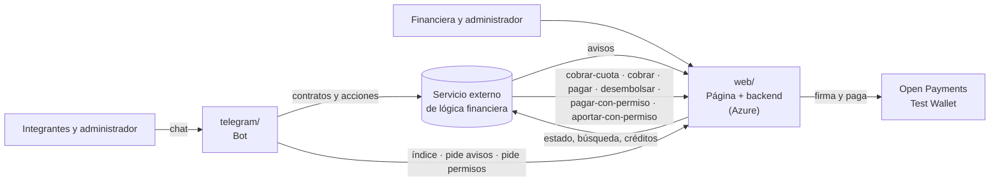

# Plan de trabajo

Actualizado el viernes 16 de octubre a las 17:30. Los pagos de Open Payments pasan al backend de la web, la web se despliega en Azure, los avisos llegan a través de la web y entra la versión 0.2.0 del servicio externo, con ventas entre participantes.

## La meta

Que el jurado lleve Natillera 2.0 a la ronda final y la premie por su aporte a la inclusión financiera (Premio Puntored). El mínimo aceptable es una entrega válida con **un pago real de Open Payments de punta a punta**: solicitud, autorización, ejecución y finalización.

## Cómo está armado

- **El servicio externo de lógica financiera** aplica las reglas de dinero: cupo y arranque, cobro de cada periodo, mora, actividades, crédito, ventas y liquidación. Es como un n8n que contiene la lógica financiera: no forma parte de esta hackathon y el proyecto solo lo llama por API. Sus reglas están en la [especificación funcional](discovery/4-logica-financiera/especificacion-funcional.md).
- **El backend de la web** tiene los pagos de Open Payments (lo único que habla con Open Payments y el corazón de lo que evalúa el jurado), recibe los avisos de staging y guarda lo que staging no tiene.
- **El bot** crea los contratos y ejecuta las acciones de cada persona. No mueve dinero.

## Quién lleva qué

| Quién | Qué | Mapa | Issues |
|---|---|---|---|
| **Estiven** | Bot: contratos, acciones, avisos que le pide a la web, permisos, Mini Apps | [`telegram/INTEGRACION.md`](../telegram/INTEGRACION.md) | [frente: telegram](https://github.com/fintechfy-dev/openpayments-fintechfy/issues?q=is%3Aopen+label%3A%22frente%3A+telegram%22) |
| **Johan** | Web y su backend: pantallas, índice, avisos, **pagos de Open Payments** y despliegue | [`web/INTEGRACION.md`](../web/INTEGRACION.md) y [`pagos/README.md`](../pagos/README.md) | [frente: web](https://github.com/fintechfy-dev/openpayments-fintechfy/issues?q=is%3Aopen+label%3A%22frente%3A+web%22) · [open payments](https://github.com/fintechfy-dev/openpayments-fintechfy/issues?q=is%3Aopen+label%3A%22open+payments%22) |
| **Willy** | Staging: versión 0.2.0 en el tenant, token, destino de avisos, dirección y modo real de la API de pagos, reloj de la demo, billeteras de prueba | [`integracion/README.md`](../integracion/README.md) | #55, #56, #57, #65, #66, #67, #68 |
| **Juan Rafael** | Por asignar | — | — |

## Orden de trabajo

| Cuándo | Qué |
|---|---|
| **Ahora** | Johan: **el #3**, cobrar dos veces con un mismo permiso recurrente y dos pagos con un mismo permiso de un solo uso, en la red real. Willy: confirmar la 0.2.0 en el tenant (#66), definir el token (#65), preparar las billeteras de prueba. Estiven: crear natillera y participación contra staging |
| **20:00 · punto de control** | ¿La 0.2.0 está instalada y hay capacidad para la compra? Si las dos respuestas son sí, entran las ventas (solo la compra). Se recomienda dejar las devoluciones fuera de la demo |
| **20:00 a medianoche** | Web en Azure (#68), avisos a través de la web, permisos con su vuelta al chat, `cobrar-cuota` y `pagar` reales. Antes del modo real, los dueños aprueban una vez los permisos de la billetera del grupo y de la financiera (#67). Después Willy conecta la dirección de la web y pasa la API de pagos a modo real (#55) |
| **Medianoche · punto de control** | **Un cobro real de punta a punta disparado desde staging** |
| **Madrugada** | La compra, si se aprobó a las 20:00 |
| **Sábado 06:00** | Corre el reloj real de staging: crear las natilleras de la demo después de esta hora |
| **Sábado 08:00 · punto de control** | Si todavía no hay flujo real, pasar al plan de respaldo: la lógica en modo de prueba más un pago real aparte, declarado como tal |
| **Sábado 08:00 a 10:30** | Guion de demo con 4 billeteras (US-018-TST), video del pago completo, `AI_USAGE.md` y prompts |
| **Sábado 10:30 a 11:00** | Congelar y entregar: #11 |

## Riesgos abiertos

| Riesgo | Qué hacer | Issue |
|---|---|---|
| El cobro recurrente con un solo permiso nunca se probó cobrando de verdad, y un intervalo correría en tiempo real mientras la demo adelanta fechas | Probarlo primero; para la demo, permiso sin intervalo con un tope total que alcance para cuotas, mora y actividades; plan B, un permiso de un solo uso por cuota | #3 |
| Los permisos de la billetera del grupo y de la financiera no están aprobados cuando la API pasa a modo real: fallan premios, liquidaciones y préstamos | Sus dueños los aprueban una vez antes, y la web guarda y renueva los tokens | #67 |
| El token de staging vence en plena demo | Willy define la duración y quién lo renueva | #65 |
| La 0.2.0 no está en el tenant, o la natillera se creó antes de actualizarlo (queda sellada en su versión) | Comprobarlo antes de las 20:00; crear las natilleras de la demo después | #66 |
| El monto de la respuesta de los pagos no coincide con el pedido, o la billetera no maneja pesos | Responder siempre el monto exacto en pesos; convertir solo hacia Open Payments | #4 |
| Idempotencia mal hecha: un reintento cobra dos veces, o se bloquea un pago legítimo | Llave por el cuerpo completo, no solo por la referencia | #4 |
| La web se reinicia y pierde el índice, los avisos o los tokens de los permisos | Base persistente en Azure y una sola copia corriendo | #68 |
| El reloj real de las 06:00 corre sobre las natilleras de prueba | Crear las de la demo después; Willy limpia antes las de prueba | #57 |
| El bot escucha el flujo en vivo de staging, que no trae los avisos (solo cascadas entre contratos, sin datos) | Cambiar la fuente: el bot le pide los avisos a la web, que los recibe del destino `bot-natillera` | #6 |
| Límites de la puerta de staging: 5 escrituras y 20 lecturas por segundo por dirección IP del servidor que llama (la web o el bot) | Guardar las lecturas unos segundos, traer varias con la búsqueda y no refrescar en bucle | #53 |
| Un secreto subido al repo público | `.env` desde el primer commit y rotar la clave si pasa | US-002-SEC |
