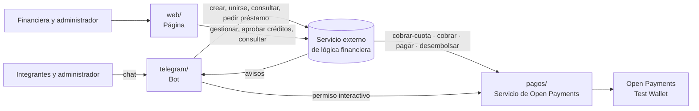

# Plan de trabajo

Actualizado el viernes 16 de octubre al mediodía: tres frentes (Telegram, Web y Pagos) sobre un servicio externo de lógica financiera, con el crédito dentro del núcleo.

## La meta

Que el jurado lleve Natillera 2.0 a la ronda final y la premie por su aporte a la inclusión financiera (Premio Puntored). El mínimo aceptable es una entrega válida con **un pago real de Open Payments de punta a punta**: solicitud, autorización, ejecución y finalización.

## Cómo está armado

- **El servicio externo de lógica financiera** aplica las reglas de dinero: cupo y arranque, cobro de cada periodo, mora, actividades, crédito y liquidación. Es como un n8n que contiene la lógica financiera: no forma parte de esta hackathon y el proyecto solo lo llama por API. Sus reglas están en la [especificación funcional](discovery/4-logica-financiera/especificacion-funcional.md).
- **El servicio de pagos** es lo único que habla con Open Payments. El servicio externo lo llama con el contrato de pagos y el bot lo usa para que cada participante apruebe su permiso en la billetera. Es el corazón de lo que evalúa el jurado.
- **El bot y la web** no mueven dinero: piden y muestran.

## Los frentes

| Frente | Para quién | Qué construye | Carpeta | Issues |
|---|---|---|---|---|
| **Telegram** | Integrantes y administrador | Crear la natillera, invitar, unirse, autorizar el cobro, ver aportes, mora y recordatorios, actividades, pedir préstamo | [`telegram/`](../telegram/) | [frente: telegram](https://github.com/fintechfy-dev/openpayments-fintechfy/issues?q=is%3Aopen+label%3A%22frente%3A+telegram%22) |
| **Web** | Financiera y administrador | Gestionar las natilleras (#9), solicitudes de crédito (#10), registro de pagos para el jurado y bitácora | [`web/`](../web/) | [frente: web](https://github.com/fintechfy-dev/openpayments-fintechfy/issues?q=is%3Aopen+label%3A%22frente%3A+web%22) |
| **Pagos** | Todo el sistema | Servicio de Open Payments (#3, #4) y la conexión con el servicio externo (#5, #6) | [`pagos/`](../pagos/) y [`integracion/`](../integracion/) | [frente: pagos](https://github.com/fintechfy-dev/openpayments-fintechfy/issues?q=is%3Aopen+label%3A%22frente%3A+pagos%22) |

Cada uno se asigna los issues en GitHub. Lo que toca a todos tiene la etiqueta [`transversal`](https://github.com/fintechfy-dev/openpayments-fintechfy/issues?q=is%3Aopen+label%3Atransversal), y lo que llama a Open Payments, la etiqueta [`open payments`](https://github.com/fintechfy-dev/openpayments-fintechfy/issues?q=is%3Aopen+label%3A%22open+payments%22).

## Contratos entre piezas

Se acuerdan primero y se escriben en el README de cada carpeta, para que cada frente avance sin esperar al otro.

| De → a | Qué | Dónde se define |
|---|---|---|
| Servicio externo → Pagos | `POST /cobrar-cuota`, `/cobrar`, `/pagar`, `/desembolsar` con `X-Api-Key` | Ya existe: [`open-payments.api.json`](discovery/4-logica-financiera/apis/open-payments.api.json); se implementa en #4 |
| Bot → Pagos | Iniciar el permiso interactivo y recibir la vuelta a la app | `pagos/README.md`, en #4 |
| Bot y Web → servicio externo | Crear y consultar natilleras, participantes, aportes y créditos | `integracion/README.md`, en #5 |
| Servicio externo → Bot | Avisos: cobro hecho, permiso rechazado, mora, préstamo, liquidación | `integracion/README.md` y `telegram/README.md`, en #6 |

## Orden de trabajo

| Cuándo | Qué |
|---|---|
| **Viernes, ahora a 14:00** | #3 probar el cobro recurrente con un solo permiso · #4 servicio de pagos con un primer cobro real · #5 conexión con el servicio externo · #7 y #8 esqueletos del bot y la web |
| **Viernes 15:00 · checkpoint** | Si van atrasados, se recorta en orden: `recorte 1` actividades → `recorte 2` mora diaria → `recorte 3` bitácora → `recorte 4` monitoreo. Lo `núcleo` no se toca, y ahora incluye el crédito. |
| **Viernes 15:00 a 17:30** | Ciclo de punta a punta: crear → unirse → autorizar → cobrar → liquidar, más pedir, aprobar y desembolsar un préstamo, visto en el bot y en la web |
| **Sábado 08:00 a 10:30** | Guion de demo con 4 billeteras (US-018-TST), video del pago completo, `AI_USAGE.md` y prompts |
| **Sábado 10:30 a 11:00** | Congelar y entregar: #11 |

## Riesgos abiertos

| Riesgo | Qué hacer | Issue |
|---|---|---|
| Que Open Payments no permita cobrar cada periodo con un solo permiso | Probarlo primero; si no, rediseñar el cobro antes de construir encima | #3 |
| El alcance creció: tres frentes, web para la financiera y crédito en el núcleo | Respetar el orden de recorte del checkpoint de las 15:00; si aun así no alcanza, decidir allí qué sale | — |
| Dónde corre el servicio externo en la demo, si cada sala de jurado usa una sola laptop | Decidirlo al conectarlo y tener el video como respaldo | #5 |
| Un secreto subido al repo público | `.env` desde el primer commit y rotar la clave si pasa | US-002-SEC |
