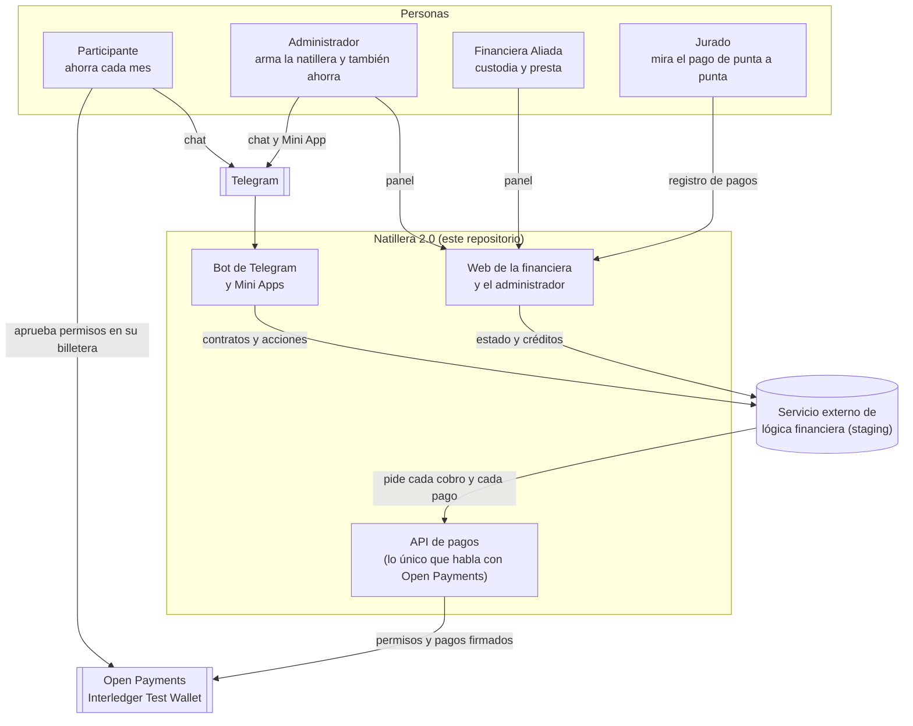
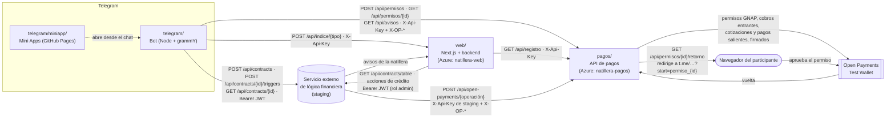
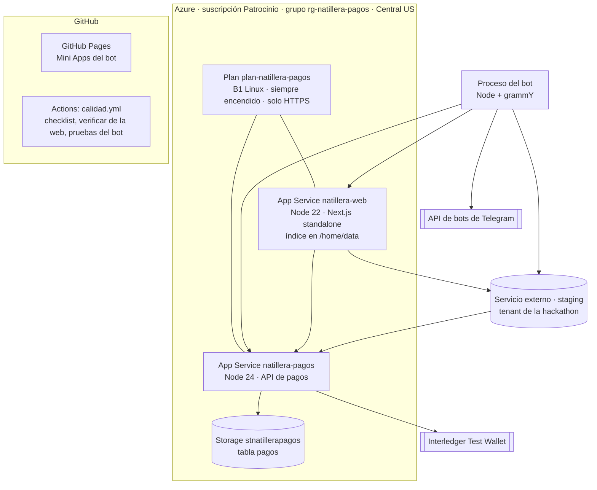
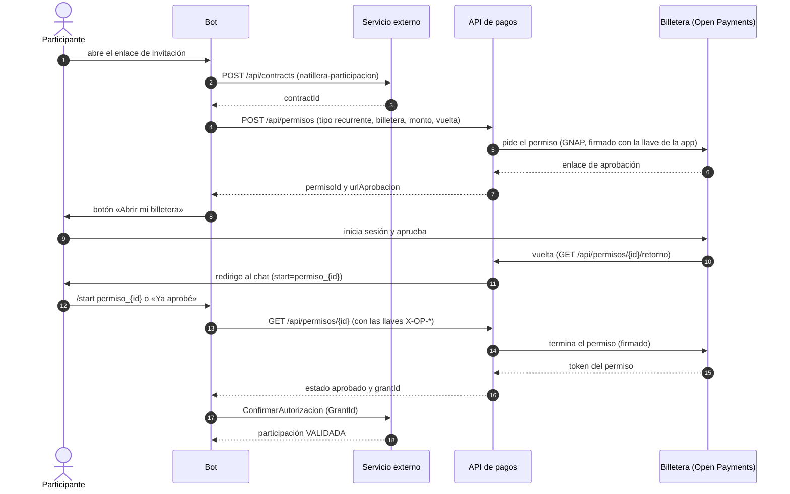
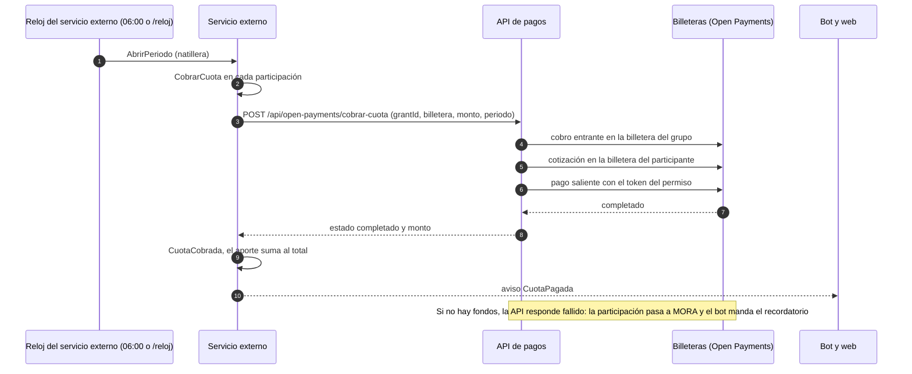
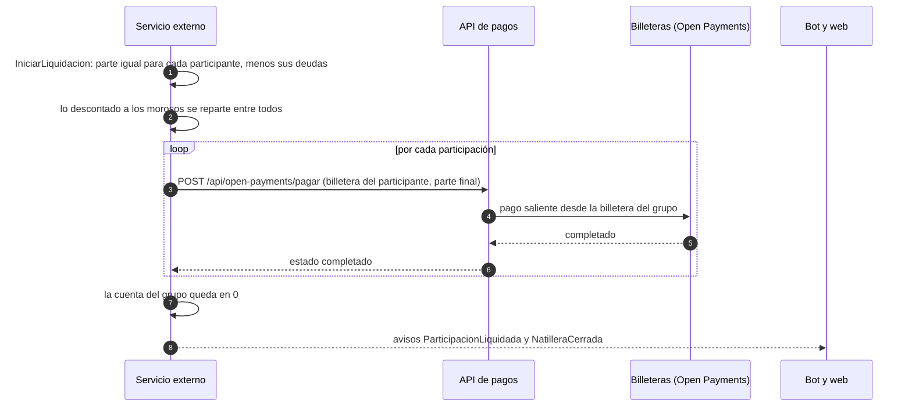
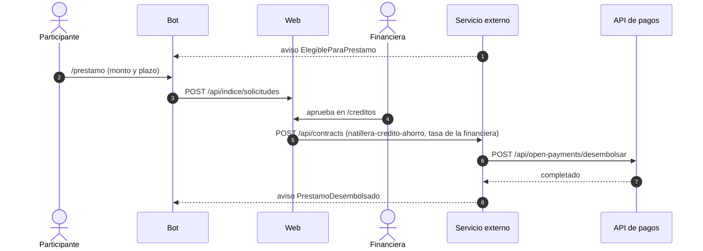
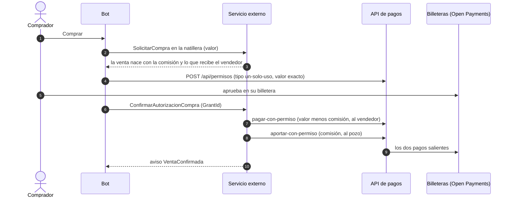

# Arquitectura

Cómo está armada Natillera 2.0, quién habla con quién y cómo viaja el dinero. Los diagramas son Mermaid: GitHub los
dibuja solos. El resumen corto está en [`docs/plan-de-trabajo.md`](../plan-de-trabajo.md); aquí va el detalle.

## 1. Contexto

Quién usa el sistema y con qué sistemas de afuera habla.

- **El servicio externo de lógica financiera** aplica las reglas de dinero (cupo, cobro de cada periodo, mora,
  actividades, crédito y liquidación). Es como un n8n que ya contiene la lógica financiera: no se escribió en la
  hackathon y el proyecto solo lo llama por API. Sus reglas están en la
  [especificación funcional](../discovery/4-logica-financiera/especificacion-funcional.md).
- **La API de pagos** es la única pieza que firma con las llaves de Open Payments. El bot, la web y el servicio
  externo nunca hablan directo con una billetera.

## 2. Piezas y contratos entre ellas

Cada flecha dice qué ruta se llama y con qué credencial. Ninguna credencial viaja por Telegram.

| Pieza | Qué hace | Qué NO hace | Mapa |
|---|---|---|---|
| Bot | Crea la natillera y las participaciones, ejecuta las acciones de cada persona, pide los permisos a la API de pagos y avisa por chat | No mueve dinero ni guarda llaves | [`telegram/INTEGRACION.md`](../../telegram/INTEGRACION.md) |
| Web | Panel de la financiera y del administrador: natilleras, créditos, registro de pagos, bitácora. Guarda en su índice lo que staging no guarda (nombres, administrador, solicitudes) | No mueve dinero | [`web/INTEGRACION.md`](../../web/INTEGRACION.md) |
| API de pagos | Pide y termina los permisos de Open Payments, ejecuta cada cobro y cada pago, y deja las cuatro etapas de cada pago para el jurado | No decide cuánto ni cuándo: eso lo dice el servicio externo | [`pagos/API.md`](../../pagos/API.md) |
| Servicio externo | Reglas de dinero, calendario de cobros, mora, liquidación, crédito y ventas | No es parte de la hackathon | [`integracion/README.md`](../../integracion/README.md) |

Las operaciones que el servicio externo le pide a la API de pagos son seis: `cobrar-cuota`, `cobrar`, `pagar`,
`desembolsar`, `pagar-con-permiso` y `aportar-con-permiso` (las dos últimas, de las ventas).

## 3. Despliegue

- Las dos App Service comparten el plan B1 (una sola copia cada una). El grupo se borra completo después del evento.
- La configuración y las llaves viven en las variables de entorno de cada App Service y en los `.env` locales, nunca
  en el repositorio (`.claude/rules/secretos.md`).
- Las llaves de Open Payments llegan en cada llamada (`X-OP-*`) y no se guardan: la API solo guarda la huella de la llave
  que pidió cada permiso.

## 4. Flujos

### 4.1 Unirse y autorizar el cobro automático (US-004, US-005)

El participante aprueba UNA vez un permiso recurrente: hasta el valor de la cuota, una vez por periodo, hasta la fecha
final. Solo la aplicación tiene llaves de Open Payments; el participante solo aprueba en su billetera.

El token del permiso se queda en la API de pagos: ni el bot ni el chat lo ven.

### 4.2 Cobro de cada cuota (US-006, US-007, US-017)

Las cuatro etapas de cada pago (solicitud, autorización, ejecución y finalización) quedan en el registro de la API de
pagos, y la web las muestra en `/pagos` para el jurado.

### 4.3 Liquidación en diciembre (US-009)

### 4.4 Crédito desde el ahorro (US-014, US-016)

Si el préstamo sigue en mora en diciembre, el servicio externo lo descuenta de la parte del participante en la
liquidación.

### 4.5 Compra entre participantes (extra, versión 0.2.0 del servicio externo)

Una compra usa un permiso de un solo uso por el valor exacto: el servicio externo calcula la comisión (5 % por
omisión) y la API de pagos hace dos pagos desde la billetera del comprador.

