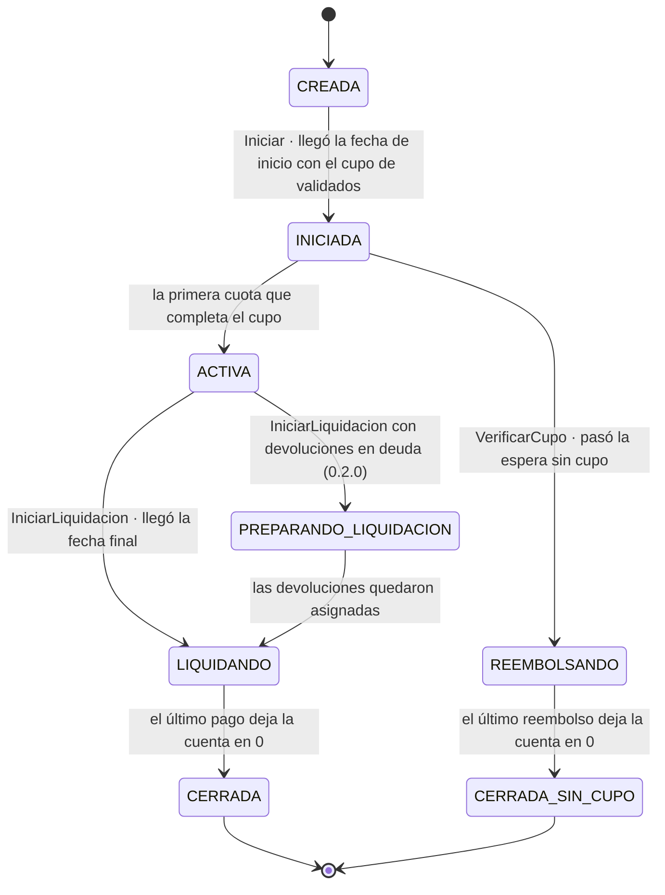
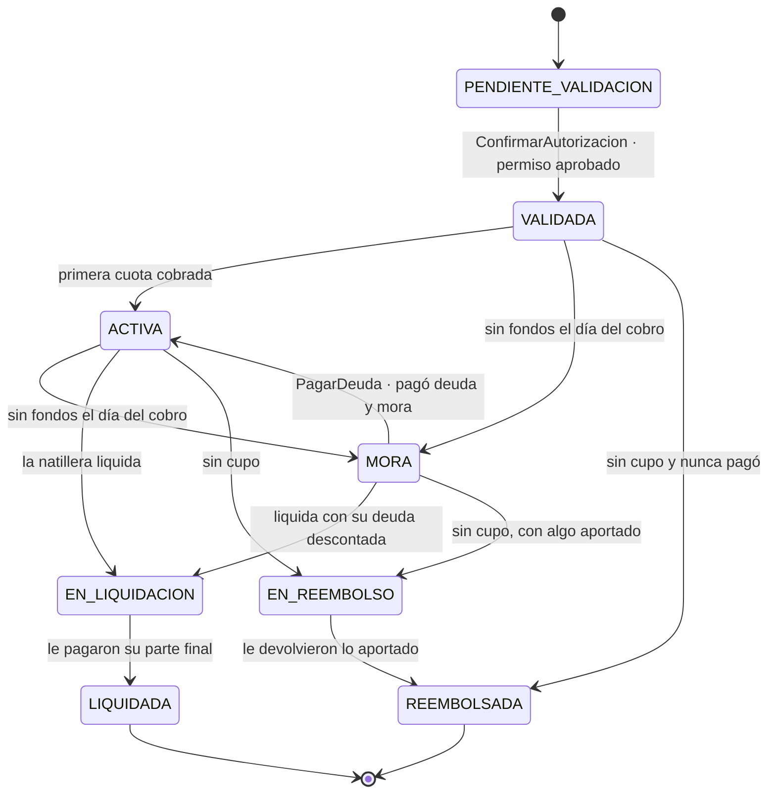
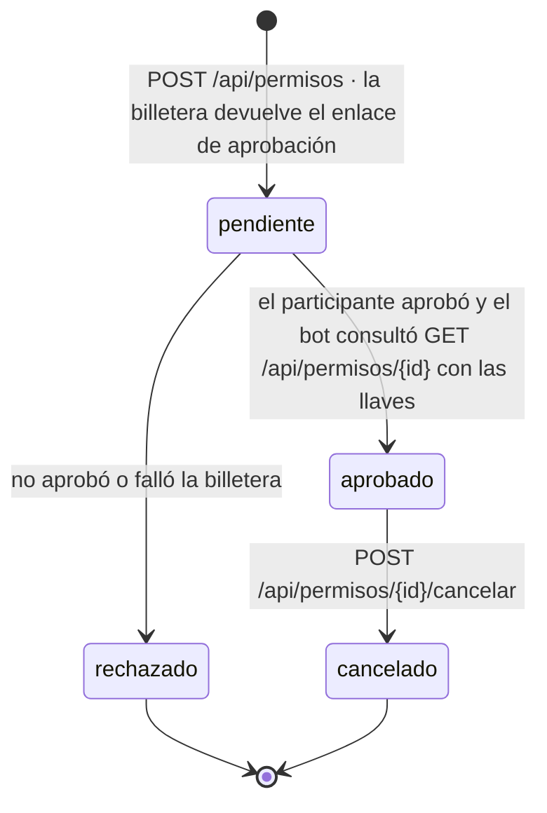
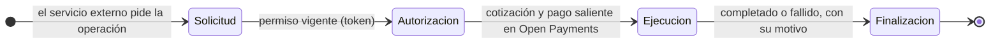
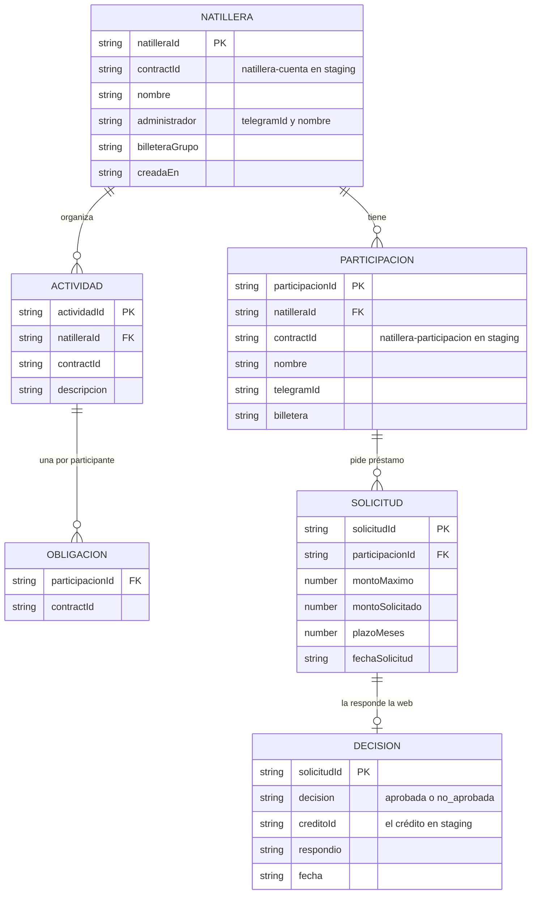

# Estados y datos

Qué estados recorre cada cosa y qué guarda cada pieza. Los estados de la natillera y de la participación son los del
servicio externo tal como el bot y la web los leen en `currentStateRaw` (el número es la posición del estado). Los
del permiso y del pago son de la API de pagos (`pagos/src/permisos.js` y `pagos/src/pagos.js`).

## 1. La natillera (`natillera-cuenta`, concepto `EstadoNatillera`)

| Número | Estado |
|---|---|
| 0 | CREADA |
| 1 | INICIADA |
| 2 | ACTIVA |
| 3 | LIQUIDANDO |
| 4 | REEMBOLSANDO |
| 5 | CERRADA |
| 6 | CERRADA_SIN_CUPO |
| 7 | PREPARANDO_LIQUIDACION |

## 2. La participación (`natillera-participacion`, concepto `EstadoParticipacion`)

Números: PENDIENTE_VALIDACION 0 · VALIDADA 1 · ACTIVA 2 · MORA 3 · EN_LIQUIDACION 4 · EN_REEMBOLSO 5 · LIQUIDADA 6 ·
REEMBOLSADA 7.

## 3. El permiso de Open Payments (API de pagos)

| Tipo | Para qué | De qué billetera |
|---|---|---|
| `recurrente` | Cuotas, deuda y actividades del participante | La del participante |
| `un-solo-uso` | Una compra o una devolución, por el valor exacto | La del comprador o la del vendedor |
| `grupo` | Pagos de la natillera: liquidación, premios y reembolsos | La del grupo (a nombre de la financiera) |
| `financiera` | Desembolsos de préstamos | La de la financiera |

Mientras el permiso termina, la API lo marca por dentro como `aprobando` y responde `pendiente`.

## 4. Un pago y sus cuatro etapas (lo que ve el jurado)

Cada etapa queda con su hora y su estado en el registro (`GET /api/registro`) y la web la dibuja con `LineaTiempoPago`.

## 5. Qué guarda cada pieza

- **Índice de la web** (`web/src/lib/indice/tipos.ts`, en `/home/data/indice.json` en Azure): lo que staging no guarda
  y la web necesita para mostrar, como los nombres, el administrador y las solicitudes de crédito. Lo alimenta el bot
  con `POST /api/indice/{tipo}` (natilleras, participaciones, actividades, solicitudes); las decisiones las escribe
  solo la web. Un reintento con los mismos datos responde 200; con otros datos, 409 y no cambia nada.
- **API de pagos** (`pagos/src/almacen.js`, tabla `pagos` en Azure Storage): una fila por objeto, con el tipo como
  partición (permisos con sus tokens, pagos con sus etapas, avisos e idempotencia). Nunca guarda las llaves de Open
  Payments: solo la huella de la llave que pidió cada permiso.
- **Servicio externo**: el estado de cada contrato (saldos, deudas, estados) y su historia de eventos. Es la fuente de
  verdad del dinero; el bot y la web solo leen `currentStateRaw` y ejecutan acciones.
