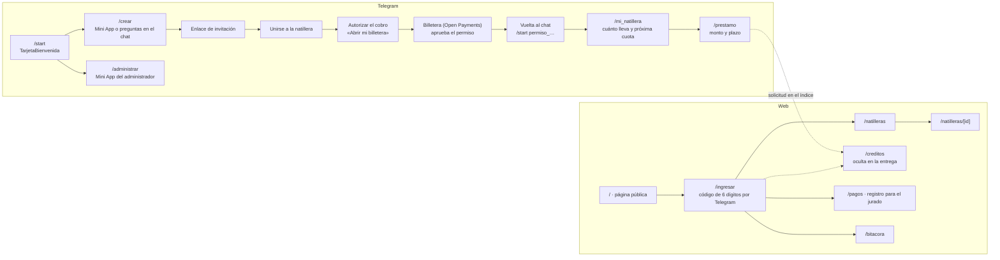
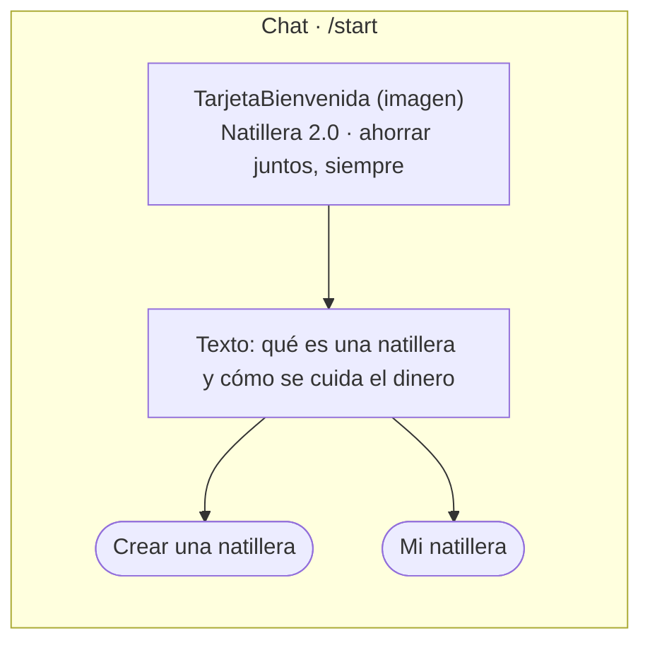
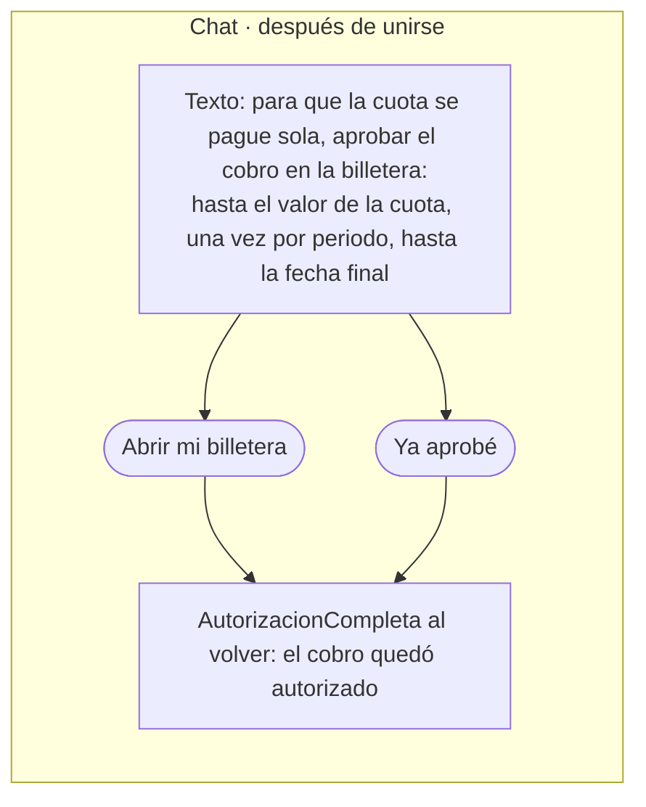
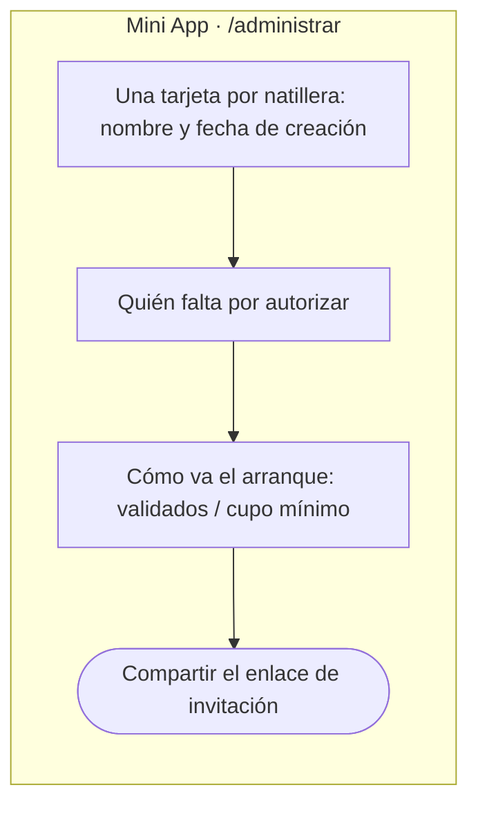
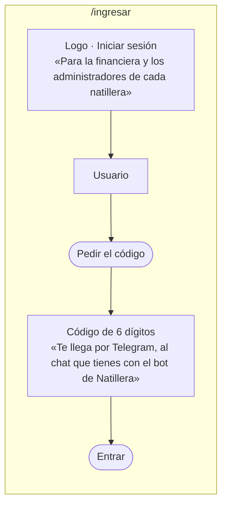
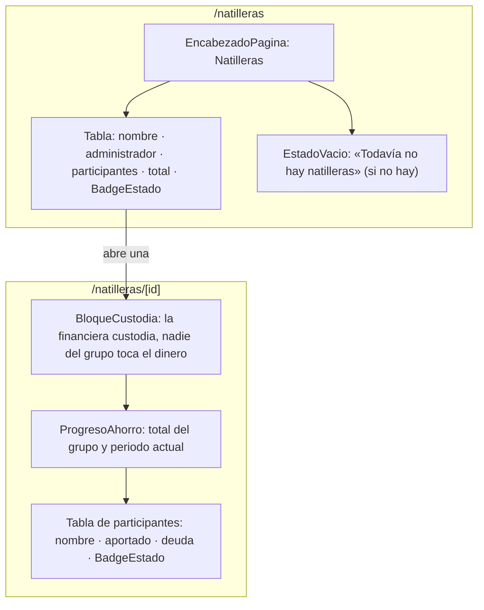
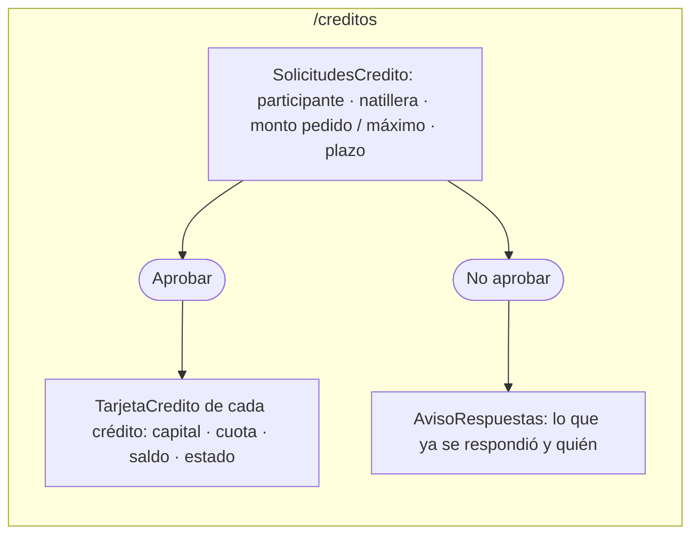
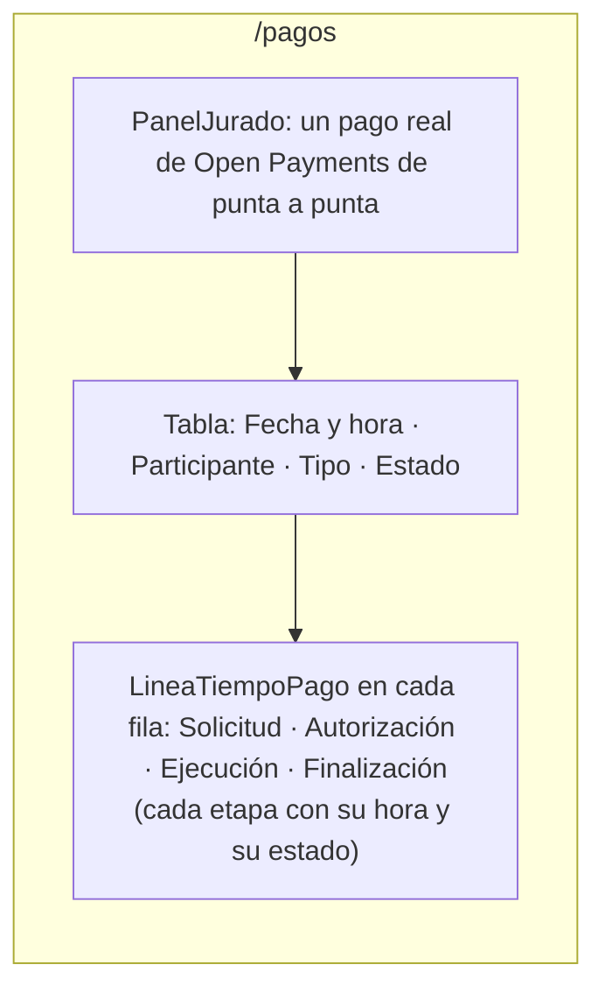
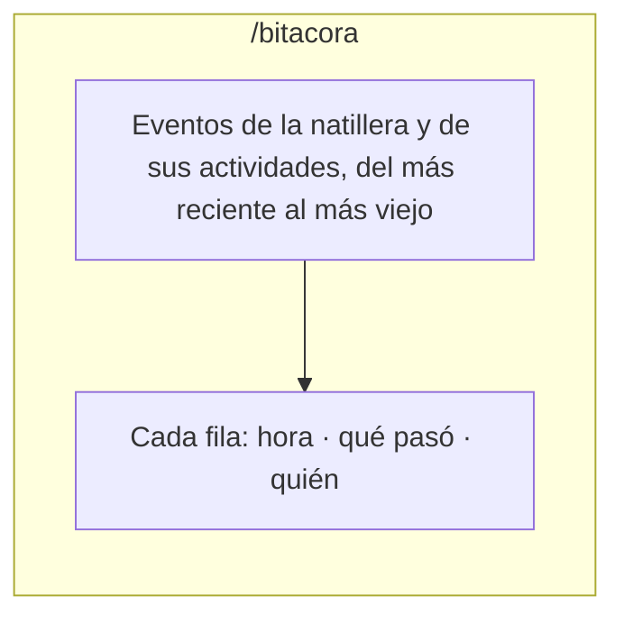

# Maquetas

Maquetas de baja fidelidad en Mermaid: qué pantallas hay, cómo se llega a cada una y qué bloques las arman. El detalle
visual (colores, tipografía, componentes) está en el [design system](../../design-system/README.md); las capturas
reales de la web se sacan con `npm run capturas` en `web/`. Los textos entre comillas «» salen del código; los demás
describen el bloque y pueden no ser literales.

## 1. Mapa de pantallas

## 2. Bot de Telegram

### Bienvenida

### Autorizar el cobro automático

### Mi natillera

```mermaid
flowchart TB
  subgraph Mia["Chat o Mini App · /mi_natillera"]
    direction TB
    M1["Nombre de la natillera · BadgeEstado (Activa, Mora…)"]
    M2["ProgresoAhorro: lo que lleva / lo que va a juntar"]
    M3["TarjetaAporte: última cuota y próxima fecha de cobro"]
    M4(["El botón que le toca:<br/>Autorizar el cobro · Pagar la deuda · Pedir préstamo"])
    M1 --> M2 --> M3 --> M4
  end
```

### Panel del administrador

## 3. Web de la financiera y el administrador

### Ingresar

### Natilleras

### Créditos

**Oculta en la entrega:** el flujo no se alcanzó a probar de punta a punta, así que `/creditos` no sale en el menú y responde 404. Se vuelve a mostrar con `SECCION_CREDITOS_VISIBLE` en `web/src/lib/secciones.ts`.

### Registro de pagos para el jurado

### Bitácora del administrador

