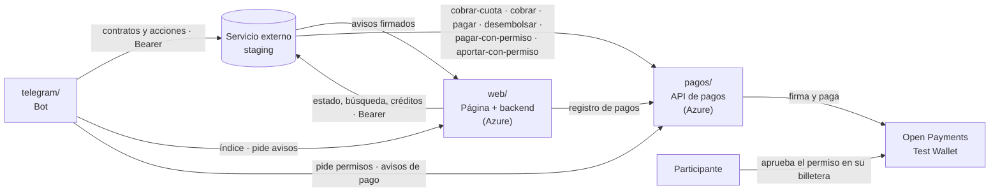

# Integración con el servicio externo (staging)

Referencia del **servicio externo de lógica financiera** (como un n8n que contiene la lógica financiera) que está en staging, y de cómo se conecta con el bot, la web y los pagos. Actualizada el viernes 16 de octubre a las 19:30, contrastada con el OpenAPI de staging, con la configuración de su puerta de entrada y con la versión 0.2.0 del ecosistema `FND-20261015-natillera-2`: 7 contratos y 50 reglas, con ventas entre participantes.

**Mapas por frente, con cada llamada:**

- **Bot (Estiven):** [`../telegram/INTEGRACION.md`](../telegram/INTEGRACION.md)
- **Web (Johan):** [`../web/INTEGRACION.md`](../web/INTEGRACION.md)
- **API de pagos:** [`../pagos/API.md`](../pagos/API.md) (cómo usarla) y [`../pagos/README.md`](../pagos/README.md) (el contrato con staging)

## Cómo se conecta todo

**Decisiones del 16 de octubre:**

1. El bot y la web llaman directo a staging desde su servidor, con el token de staging.
2. **Los pagos de Open Payments viven en una API aparte, en `pagos/`**, publicada en `https://natillera-pagos.azurewebsites.net` (PR #71). La escribió Claude Code y así se declara. Staging la llama en `/api/open-payments/*`, el bot le pide los permisos y los avisos de pago, y la web lee su registro ([`../pagos/API.md`](../pagos/API.md)).
3. **La web se despliega en Azure** con una dirección pública HTTPS fija (#68). La necesitan staging, para mandar los avisos, y el bot, para el índice y los avisos.
4. **Los avisos de staging llegan a la web y el bot se los pide** cada pocos segundos. El bot no necesita dirección pública.
5. La web guarda lo que staging no tiene: nombres, ids de Telegram y la cola de solicitudes de crédito. Para listar y buscar contratos se puede usar la búsqueda de staging.
6. **Ventas:** documentadas aquí; a las 20:00 se decide si entran a la demo. **Devoluciones:** documentadas; se recomienda dejarlas fuera de la demo.

## Lo que expone staging

Todo pasa por la puerta de entrada de staging, con `Authorization: Bearer <token>`. No sirve un token de sesión común: la puerta exige un JWT emitido con la plantilla de Clerk `motorcredito` (audiencia `motorcredito-api`) y el `org_id` del tenant. Para crear contratos y disparar acciones, el token necesita el rol `writer` o `admin`; con `reader` responde 403. El token **vence**: Willy define cuánto dura y quién lo renueva durante la demo (#65). Nunca va al navegador ni al repo.

| Operación | Ruta | La usa |
|---|---|---|
| Crear un contrato | `POST /api/contracts` con `{ "templateName", "parameters" }` → `contractId` y `correlationId` | Bot (natillera, participación, actividad); web (crédito) |
| Estado de un contrato | `GET /api/contracts/{contractId}`: leer `currentStateRaw`; el nombre de cada estado viene en `currentStateLabels` | Bot y web |
| Ejecutar una acción | `POST /api/contracts/{contractId}/triggers` con `{ "trigger", "parameters" }` y el encabezado `Idempotency-Key` | Bot |
| Historia de un contrato | `GET /api/contracts/{contractId}/events` | Web (pagos y bitácora) |
| Listar contratos | `GET /api/contracts` (paginado; filtra por `templateName`, `filterConcept` y `filterQuery`) | Web |
| Buscar contratos | `POST /api/contracts/search` (filtros por varios conceptos, y/o, orden, hasta 500) | Web y bot |
| Contar contratos | `GET /api/contracts/count` | Web |
| Cascada de una acción | `GET /api/contracts/correlation/{correlationId}` | Bot |
| Cascadas recientes | `GET /api/contracts/correlations/recent` | Para depurar |
| ¿Está instalada la 0.2.0? | `GET /api/templates/natillera-venta/schema` (404 = no) | Willy |

**Solo para administrador (Willy):** el destino de avisos (`POST /api/webhooks/destinos`), la dirección, los encabezados fijos y la llave de la API de pagos (`PATCH /api/integraciones/apis/open-payments` y `PUT /api/integraciones/apis/open-payments/credencial`), las acciones del reloj y la limpieza de contratos de prueba (`DELETE /api/contracts/all`).

**`POST /api/webhooks` no existe en la puerta** (responde 404). **El flujo en vivo `GET /api/events/stream` sí existe**, por una entrada directa y con el mismo token, pero no sirve para los avisos: solo publica las cascadas entre contratos (`sourceEvent`, `sourceContractId`, `targetContractId`, `targetTrigger`), sin los datos del evento, y lo que no dispara otro contrato no pasa por ahí. Los avisos llegan solo por el destino `bot-natillera`.

**Parámetros:** cada uno va tipado, `{ "type": "Text", "value": "nat-001" }`. Los tipos son `Text`, `Currency`, `Integer`, `Percentage` (**fracción: 1 % = 0.01**) y `Date` (`AAAA-MM-DD`).

**Reglas al llamar:**

- Un `200` en una acción no garantiza que corrió. Hay que revisar `results[]`: si todas traen `preconditionFailed`, `requiredStateFailed` o `hasInvalidTransition`, fue rechazada.
- Las cascadas entre contratos son asíncronas. El contrato que nace por una regla (obligación, venta, devolución) todavía no existe cuando vuelve el `200`. Hay que esperar su aviso, o buscarlo con pausas (1, 2 y 4 segundos).
- **`Idempotency-Key`: una llave por acción lógica**, no por toque. Por ejemplo, la compra usa una llave derivada de su `VentaId`, y si el usuario toca «Comprar» otra vez se manda la **misma** llave: staging devuelve la respuesta guardada sin repetir la acción. Si la primera sigue en curso, responde `409`, que significa «ya en curso», no error. La llave dura 24 horas y vale por método y ruta.
- **Crear un contrato (`POST /api/contracts`) no acepta esa llave**: solo las acciones la tienen. Si la creación se cae por tiempo, hay que buscar el contrato por su id propio (`POST /api/contracts/search`) antes de reintentar, para no crearlo dos veces.
- Límites de la puerta, por dirección IP del servidor que llama (el de la web en Azure o el del bot, no la laptop de la demo): 5 escrituras por segundo (crear contratos y disparar acciones) y 20 lecturas por segundo. Para todo staging, el tope es de 25 acciones por segundo.

## Los contratos

| Contrato | Cómo nace | Parámetros |
|---|---|---|
| `natillera-cuenta` | El bot lo crea cuando el administrador arma la natillera | `NatilleraId`, `NombreNatillera`, `ValorCuota`, `FechaInicio`, `FechaFinal`, `PeriodicidadMeses`, `CupoMinimo`, `PorcentajeMoraDiaria`, `DiasEsperaCupo`, `PagosParaPrestamo`, `MultiploPrestamo`. Opcionales desde la 0.2.0: `PorcentajeComision` (0.05 por omisión) y `PlazoDevolucionDias` (8 por omisión) |
| `natillera-participacion` | El bot la crea cuando un participante se une | `ParticipacionId`, `NatilleraId`, `ParticipanteId` (id de Telegram), `WalletParticipante`, `ValorCuota`, `NumeroCuotas`, `PorcentajeMoraDiaria`, `PagosParaPrestamo`, `MultiploPrestamo`, `FechaInicio` |
| `natillera-actividad` | El bot la crea cuando el administrador arma una rifa, bazar o compartir | `ActividadId`, `NatilleraId`, `Descripcion`, `ValorPorParticipante`, `Premio`, `NumeroParticipantes`, `CastigoMoraDiario`, `FechaActividad`, `FechaPago` |
| `natillera-credito-ahorro` | La web lo crea cuando la financiera aprueba un préstamo | `CreditoId`, `ParticipacionId`, `ParticipanteId`, `NatilleraId`, `WalletParticipante`, `Capital`, `TasaMensual`, `PlazoMeses`, `FechaInicio` |
| `natillera-obligacion-actividad` | **No se crea a mano.** Una regla crea una por participante cuando nace una actividad | — |
| `natillera-venta` | **No se crea a mano.** Una regla la crea cuando el bot dispara `SolicitarCompra` en la natillera. Su `contractId` llega en el aviso `AutorizacionCompraPendiente` | — |
| `natillera-devolucion` | **No se crea a mano.** Una regla la crea cuando el bot dispara `SolicitarDevolucion` en la venta. Su `contractId` llega en el aviso `DevolucionPedida` | — |

Las llaves de negocio (`NatilleraId`, `ParticipacionId`, `ActividadId`, `VentaId`, `CreditoId`) las genera quien crea o dispara, y no cambian nunca.

## Las acciones

**Públicas** (las llaman el bot o la web con su token de rol `writer`):

| Acción | Contrato | Cuándo | Parámetros |
|---|---|---|---|
| `ConfirmarAutorizacion` | participación | Aprobó el permiso recurrente de su billetera | `PermisoAprobado` = 1, `BilleteraVerificada` = 1, `GrantId` |
| `RechazarAutorizacion` | participación | No aprobó o falló la billetera | `Motivo` |
| `PagarDeuda` | participación | El moroso avisa que ya tiene el dinero | — |
| `AutorizarPago` | obligación de actividad | Paga su parte de la actividad | — |
| `IndicarGanador` | actividad | El administrador indica y confirma al ganador | `GanadorParticipacionId`, `WalletGanador`, `GanadorConfirmado` = 1 |
| `CerrarSinPremioOSinGanador` | actividad | Sin premio o sin ganador | — |
| `PagoRecibido` | crédito | El participante pagó su préstamo (solo lo registra, no cobra) | `MontoPago`, `Referencia` |
| `ReintentarPagoPremio` | natillera | Falló el pago de un premio | `ActividadId`, `MontoPremio`, `GanadorParticipacionId`, `WalletGanador` |
| `SolicitarCompra` | natillera | El comprador toca «Comprar» (solo con la natillera activa) | `VentaId`, `CompradorParticipacionId`, `VendedorParticipacionId`, `WalletComprador`, `WalletVendedor`, `ProductoId`, `Valor`, `VendedorEsAdministrador` (0/1) |
| `ConfirmarAutorizacionCompra` | venta | El comprador aprobó su permiso de un solo uso | `PermisoAprobado` = 1, `GrantId` |
| `CancelarCompra` | venta | Negó, canceló o pasaron 15 minutos | `Motivo` |
| `SolicitarDevolucion` | venta | El comprador la pide dentro del plazo | `Motivo` |
| `AprobarVendedor` / `AprobarAdministrador` | devolución | Voto a favor | — |
| `NegarVendedor` / `NegarAdministrador` | devolución | Voto en contra | `Motivo` |
| `AutorizarPagoDevolucion` | devolución | El vendedor aprobó su permiso de un solo uso | `PermisoAprobado` = 1, `GrantId` |
| `RegistrarNoPagoVendedor` | devolución | El vendedor no autorizó en 15 minutos o se negó (**obligatorio**) | — |
| `AutorizarPagoDeuda` | devolución | El vendedor en deuda paga antes de la fecha final | `PermisoAprobado` = 1, `GrantId` (un permiso nuevo) |
| `ReintentarDevolucionComision` | natillera | Falló la devolución de la comisión | `VentaId`, `WalletComprador`, `Monto` |

**Staging no sabe quién llama.** El bot tiene que comprobar que quien compra es el comprador, que comprador y vendedor son distintos y están validados, y que quien vota como vendedor o como administrador lo es de verdad.

**Del reloj** (rol de administrador): `Iniciar`, `AbrirPeriodo`, `CausarMoraDiaria`, `VerificarCupo`, `IniciarLiquidacion`, `CausacionDiaria`, `VencimientoCuota`, `VencerSinPago`, `CausarCastigoDiario`, `VencerPlazoDevolucion`, `RecordarDecision`, y los reintentos `ReintentarPagoLiquidacion`, `ReintentarReembolso` y `ReintentarDesembolso`. Staging las corre solo a las 06:00 hora de Bogotá. En la demo las dispara Willy con la fecha simulada (`CurrentDate`). `CobrarCuota` no es del reloj: la disparan las reglas después de `Iniciar` y `AbrirPeriodo`; dispararla a mano pide la cuota otra vez.

## El ciclo en llamadas

1. **Crear la natillera:** el bot crea `natillera-cuenta` y guarda el `contractId`.
2. **Unirse:** el bot crea `natillera-participacion`.
3. **Permiso recurrente:** el bot le pide un permiso a la API de pagos. El participante lo aprueba en su billetera y vuelve al chat. Con el `GrantId`, el bot llama `ConfirmarAutorizacion`.
4. **Arranque:** `Iniciar` en la fecha de inicio. Staging pide a la API de pagos `/cobrar-cuota` por cada participante; cuando paga el cupo, la natillera queda activa.
5. **Cada periodo:** `AbrirPeriodo` y otra vez `/cobrar-cuota`.
6. **Mora:** `CausarMoraDiaria` manda el recordatorio. El participante responde, el bot llama `PagarDeuda` y staging pide `/cobrar`.
7. **Actividad:** el bot crea `natillera-actividad`. Cada participante paga con `AutorizarPago` y `IndicarGanador` paga el premio con `/pagar`.
8. **Crédito:** llega el aviso `ElegibleParaPrestamo`, el bot ofrece el préstamo y registra la solicitud en la web. Cuando la financiera la aprueba, la web crea `natillera-credito-ahorro` y staging pide `/desembolsar`.
9. **Liquidación:** `IniciarLiquidacion` reparte con `/pagar` y la natillera cierra en 0. No corre mientras haya ventas con pagos en curso. Si hay devoluciones en deuda, la primera vez deja la natillera en el estado 7, `PREPARANDO_LIQUIDACION`, y el reparto ocurre con la del día siguiente: el reloj se dispara dos veces.
10. **Venta** (si entra a la demo): el bot dispara `SolicitarCompra`. Llega `AutorizacionCompraPendiente` con el `contractId` de la venta, y el bot pide a la API de pagos un permiso de un solo uso del comprador por el valor completo. Con el permiso aprobado, el bot llama `ConfirmarAutorizacionCompra`. Staging pide a la API de pagos `/pagar-con-permiso` (el valor menos la comisión, al vendedor) y `/aportar-con-permiso` (la comisión, a la natillera), y llega `VentaConfirmada`. Si el comprador no aprueba en 15 minutos, el bot llama `CancelarCompra`.
11. **Devolución** (se recomienda dejarla fuera de la demo): `SolicitarDevolucion` → votos → `DevolucionAprobada`. La comisión vuelve sola al comprador por `/pagar`. El vendedor aprueba un permiso de un solo uso y el bot llama `AutorizarPagoDevolucion`, con lo que staging pide `/pagar-con-permiso`. Si el vendedor no aprueba en 15 minutos, el bot **tiene que** llamar `RegistrarNoPagoVendedor`; si no, la natillera nunca liquida.

## Avisos

Willy da de alta el destino `bot-natillera` con `POST /api/webhooks/destinos` y `{ "nombre": "bot-natillera", "url": "https://<web>/api/avisos/staging" }`, y le pasa a Johan el secreto de firma.

Cada aviso llega firmado en el encabezado `X-Motor-Signature: t=<unix>,v1=<hmac>`:

- `v1` es el HMAC-SHA256 en **hexadecimal en minúsculas** de `"{t}." + cuerpo crudo`, en UTF-8.
- La llave es el secreto **completo**, con su prefijo `whsec_`, tomado como texto UTF-8: no se le quita el prefijo ni se decodifica. Las librerías de «Standard Webhooks» o Svix lo hacen distinto y nunca coincidirían.
- El cuerpo trae `id` (`evt_…`), `type` (el evento), `createdAt`, `correlationId`, `contractId`, `templateName`, `origin`, `tenantId` y `data` (los datos del evento).
- Staging reenvía el mismo aviso si la web tarda más de 10 segundos o responde 5xx (al minuto, a los 5 y 30 minutos, a las 2 y a las 12 horas), y Willy puede reenviarlo a mano: hay que **descartar repetidos por `id`** (también viene en el encabezado `X-Motor-Event-Id`).

La web verifica la firma, guarda el aviso y responde 2xx. El bot los pide con `GET /api/avisos?desde=<cursor>`. La lista completa de avisos, con a quién va cada uno, está en [`../telegram/INTEGRACION.md`](../telegram/INTEGRACION.md).

**Ojo: «cobro hecho» no es un aviso de staging.** `CuotaPagada`, `DeudaPagada` y `ObligacionPagada` existen como eventos del contrato, pero no se mandan al destino `bot-natillera`. Los avisos de pago (`PagoCompletado` y `PagoFallido`) los genera la API de pagos al terminar cada pago, y el bot se los pide a ella (`GET /api/avisos`), aparte de los de staging.

## Diferencias y cuidados

| # | Qué pasa | Qué hacer |
|---|---|---|
| 1 | Staging pide `Bearer`, no `X-Api-Key` | El bot y la web mandan el token de staging como `Bearer`. Las variables `SERVICIO_EXTERNO_TOKEN` (bot) y `SERVICIO_API_KEY` (web) guardan ese token |
| 2 | Staging no guarda nombres, ids de Telegram ni la cola de créditos | Los guarda la web; el bot se los manda. Para listar contratos se puede usar la búsqueda |
| 3 | Staging cuenta la periodicidad en meses enteros | Para la demo, solo mensual (#58) |
| 4 | El OpenAPI sugiere crear también los contratos de reglas | En la prueba local corrieron sin crearlos. Confirmar con la primera natillera (#56) |
| 5 | En staging, la dirección de la API de pagos es un ejemplo (`natillera-bff.example`) y puede estar en modo de prueba | Willy pone `https://natillera-pagos.azurewebsites.net/api/open-payments`, la credencial (`API_KEY_STAGING`, en el encabezado `X-Api-Key`), los tres encabezados `X-OP-*` con **la misma** llave del bot (como encabezados fijos: `PATCH` con `Headers`) y el modo real (#55). El modo es de toda la API: las 6 rutas tienen que responder, aunque alguna sea simulada (`OPERACIONES_SIMULADAS`). Ojo: a diferencia de la credencial, un encabezado fijo se lee con `GET /api/integraciones/apis/{id}` y cualquier token de la organización. La llave es de una billetera de prueba, pero hay que rotarla después del evento |
| 6 | Las acciones del reloj requieren rol de administrador | Las dispara Willy (#57) |
| 7 | La 0.2.0 está en el servicio externo, pero no se ha confirmado en el tenant | Comprobar con `GET /api/templates/natillera-venta/schema` (#66). Cada contrato queda sellado en la versión con la que nació: a una natillera creada antes, `SolicitarCompra` le responde 400 «Unknown Trigger». Crear las de la demo después de la actualización |
| 8 | El token de staging vence y exige la plantilla `motorcredito` con rol `writer` | Willy emite los tokens y define cuánto duran y quién los renueva (#65) |
| 9 | Staging no valida quién compra ni quién vota | Lo valida el bot |
| 10 | Una devolución aprobada sin respuesta del vendedor frena la liquidación | El bot llama `RegistrarNoPagoVendedor` a los 15 minutos |
| 11 | Una compra en el filo de la liquidación se rechaza | El bot no ofrece «Comprar» desde el día anterior a la fecha final |
| 12 | El reloj real de las 06:00 del sábado corre sobre las natilleras de prueba | Crear las natilleras de la demo después de las 06:00; Willy puede limpiar antes las de prueba |
| 13 | Los avisos `ComisionDevuelta` y `DevolucionComisionFallo` no traen `ventaId` | Asociarlos a la devolución aprobada más reciente de esa natillera; solo importa si las devoluciones entran |

## Variables

Cada mapa trae las suyas. En el repo solo va `.env.example`, sin valores.
