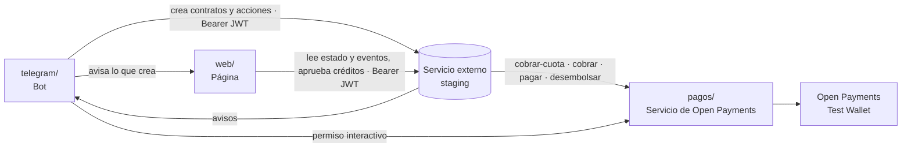

# Integración con el servicio externo (staging)

Guía para conectar el bot, la web y el servicio de pagos con el **servicio externo de lógica financiera** que ya está en staging. Contrastada el 16 de octubre contra su OpenAPI (ecosistema `FND-20261015-natillera-2`: 5 contratos y 26 reglas) y contra la [especificación funcional](../docs/discovery/4-logica-financiera/especificacion-funcional.md).

## Cómo se conecta todo

**Decisión del 16 de octubre:** no hay un puente aparte. El bot y la web llaman directo a staging desde su servidor, con el token. Como staging no lista nada, **la web guarda la lista** (natilleras, participantes, actividades y solicitudes de crédito) y **el bot le avisa** cada vez que crea algo.

**Mapas por frente, con cada llamada:**

- **Bot (Estiven):** [`../telegram/INTEGRACION.md`](../telegram/INTEGRACION.md)
- **Web (Johan):** [`../web/INTEGRACION.md`](../web/INTEGRACION.md)

Esta guía queda como referencia del servicio externo.

## Lo que expone el servicio externo

**Autenticación:** `Authorization: Bearer <JWT>` con el token de la organización del sandbox. Lo comparte Willy por canal privado y va en `integracion/.env`, nunca en el repo.

| Operación | Ruta |
|---|---|
| Crear un contrato | `POST /api/contracts` con `{ "templateName", "parameters" }` → devuelve `contractId` |
| Estado de un contrato | `GET /api/contracts/{contractId}` → leer **`currentStateRaw`** (la otra proyección es solo para mostrar) |
| Ejecutar una acción | `POST /api/contracts/{contractId}/triggers` con `{ "trigger", "parameters" }` |
| Historia de un contrato | `GET /api/contracts/{contractId}/events` |
| Registrar avisos | `POST /api/webhooks` con `{ "url", "events" }` |
| Cascadas recientes | `GET /api/correlations/recent` y `GET /api/contracts/correlation/{correlationId}` |
| Avisos en vivo | `GET /api/events/stream` (SSE) |

Cada parámetro va tipado: `{ "type": "Text", "value": "nat-001" }`. Los tipos son `Text`, `Currency`, `Integer`, `Percentage` y `Date` (`AAAA-MM-DD`).

## Los contratos

| Contrato | Se crea cuando | Parámetros |
|---|---|---|
| `natillera-cuenta` | El administrador crea la natillera en el bot | `NatilleraId`, `NombreNatillera`, `ValorCuota`, `FechaInicio`, `FechaFinal`, `PeriodicidadMeses`, `CupoMinimo`, `PorcentajeMoraDiaria`, `DiasEsperaCupo`, `PagosParaPrestamo`, `MultiploPrestamo` |
| `natillera-participacion` | Un participante se une | `ParticipacionId`, `NatilleraId`, `ParticipanteId` (Telegram), `WalletParticipante`, `ValorCuota`, `NumeroCuotas`, `PorcentajeMoraDiaria`, `PagosParaPrestamo`, `MultiploPrestamo`, `FechaInicio` |
| `natillera-actividad` | El administrador crea una rifa, bazar o compartir | `ActividadId`, `NatilleraId`, `Descripcion`, `ValorPorParticipante`, `Premio`, `NumeroParticipantes`, `CastigoMoraDiario`, `FechaActividad`, `FechaPago` |
| `natillera-credito-ahorro` | La financiera aprueba un préstamo | `CreditoId`, `ParticipacionId`, `ParticipanteId`, `NatilleraId`, `WalletParticipante`, `Capital`, `TasaMensual`, `PlazoMeses`, `FechaInicio` |
| `natillera-obligacion-actividad` | **No se crea a mano:** la crea el servicio externo para cada participante cuando nace una actividad | — |

Las llaves (`NatilleraId`, `ParticipacionId`, `ActividadId`, `CreditoId`) las genera el bot y no cambian. El bot guarda su `contractId` para llamar acciones y le avisa a la web, que guarda la lista.

## Las acciones

**Públicas** (las llaman el bot o la web con el token normal):

| Acción | Contrato | Cuándo | Parámetros |
|---|---|---|---|
| `ConfirmarAutorizacion` | participación | El participante aprobó el permiso en su billetera | `PermisoAprobado` = 1, `BilleteraVerificada` = 1, `GrantId` |
| `RechazarAutorizacion` | participación | No aprobó o falló la billetera | `Motivo` |
| `PagarDeuda` | participación | El moroso avisa por Telegram que ya tiene el dinero | — |
| `AutorizarPago` | obligación de actividad | El participante paga su parte de la actividad | — |
| `IndicarGanador` | actividad | El administrador indica y confirma al ganador | `GanadorParticipacionId`, `WalletGanador`, `GanadorConfirmado` = 1 |
| `CerrarSinPremioOSinGanador` | actividad | La actividad no tiene premio o no hubo ganador | — |
| `PagoRecibido` | crédito | El participante paga su préstamo | `MontoPago`, `Referencia` |
| `ReintentarPagoPremio` | cuenta | Falló el pago de un premio | `ActividadId`, `MontoPremio`, `GanadorParticipacionId`, `WalletGanador` |

**Del reloj** (requieren rol de administrador): `Iniciar`, `AbrirPeriodo`, `CobrarCuota`, `CausarMoraDiaria`, `VerificarCupo`, `IniciarLiquidacion`, `CausacionDiaria`, `VencimientoCuota`, `VencerSinPago` y `CausarCastigoDiario`, entre otras. El servicio externo las corre solo a las 06:00. Para la demo se disparan a mano con el parámetro `CurrentDate`, que simula la fecha, y un token con rol de administrador (ver diferencia 7).

## El ciclo en llamadas

1. **Crear la natillera:** `POST /api/contracts` con `natillera-cuenta`. Guardar el `contractId`.
2. **Unirse:** `POST /api/contracts` con `natillera-participacion`.
3. **Permiso:** el bot y el servicio de pagos hacen el permiso interactivo; con el `GrantId` el bot llama `ConfirmarAutorizacion`.
4. **Arranque:** `Iniciar` en la fecha de inicio. El servicio externo pide la primera cuota a cada participante (`/cobrar-cuota` del servicio de pagos) y, cuando paga el cupo, la natillera queda activa.
5. **Cada periodo:** `AbrirPeriodo` y otra vez `/cobrar-cuota`.
6. **Mora:** `CausarMoraDiaria` manda el recordatorio. El participante responde, el bot llama `PagarDeuda` y el servicio externo pide `/cobrar`.
7. **Actividad:** `POST /api/contracts` con `natillera-actividad`, cada uno `AutorizarPago`, y `IndicarGanador` paga el premio con `/pagar`.
8. **Crédito:** llega el aviso `ElegibleParaPrestamo`, el bot ofrece el préstamo y el bot registra la solicitud en la web. Cuando la financiera la aprueba, la web crea `natillera-credito-ahorro` y el servicio externo pide `/desembolsar`.
9. **Liquidación:** `IniciarLiquidacion` reparte con `/pagar` a cada uno y la natillera cierra en 0.

## Avisos (webhooks)

`POST /api/webhooks` con la URL pública del bot y la lista de eventos. El alta devuelve el `signingSecret` **una sola vez**: guárdalo en `.env`. Cada aviso llega firmado en el encabezado `X-Motor-Signature: t=<unix>,v1=<hmac>`, que es un HMAC-SHA256 de `"{t}.{body}"` con ese secreto. Verifica la firma antes de procesar y responde 2xx.

Los que le interesan al bot: `NatilleraActivada`, `CuotaPagada`, `EntradaEnMora`, `RecordatorioMora`, `SalidaDeMora`, `AutorizacionRechazada`, `ElegibleParaPrestamo`, `PrestamoDesembolsado`, `RecordatorioObligacion`, `PremioPagadoAlGanador`, `ParticipacionLiquidada`, `NatilleraCerrada`, `NatilleraCerradaSinCupo`, y los de fallo (`CobroDeudaFallo`, `PagoLiquidacionFallo`, `PagoPremioFallo`, `DesembolsoFallo`, `ReembolsoFallo`).

La URL tiene que ser HTTPS y alcanzable desde staging. Si no hay URL pública, la alternativa es leer `GET /api/events/stream`.

## Diferencias encontradas

| # | Diferencia | Qué hacer |
|---|---|---|
| 1 | El servicio externo pide `Bearer JWT`; la web usaba `X-Api-Key` | La web cambia a `Bearer` hacia staging; la `X-Api-Key` queda para lo que el bot le avisa a la web |
| 2 | El servicio externo no tiene listas, ni solicitudes de crédito, ni bitácora | La web guarda la lista y arma la bitácora con los eventos |
| 3 | El servicio externo cuenta la periodicidad en **meses enteros** (`PeriodicidadMeses`); el bot ofrece «quincenal» | Para la demo, solo mensual (#58). Quincenal exige cambiar el servicio externo, fuera de la hackathon |
| 4 | Nombres de las personas, administrador y billetera del grupo no viven en el servicio externo | Los manda el bot y los guarda la web |
| 5 | El OpenAPI sugiere crear los 26 contratos de reglas después de los contratos base; la especificación dice que instalar el ecosistema basta | En la prueba local del FND las reglas corrieron sin crearlos. **Confirmar en staging** con la primera natillera (#56) |
| 6 | En staging la API de pagos apunta a `https://natillera-bff.example`, que no existe, y puede estar en modo de prueba | Configurarla en modo real con la URL pública del servicio de pagos. Sin eso no se mueve dinero real y se cae el criterio de Open Payments |
| 7 | Las acciones del reloj requieren rol de administrador | Para la demo, un token con ese rol o disparar el reloj desde staging |
| 8 | Lo nuevo de ventas y devoluciones no está en staging | No construir contra eso |

## Variables

Están en cada mapa: `SERVICIO_EXTERNO_URL` y `SERVICIO_EXTERNO_TOKEN` en el bot y en la web; `WEB_INDICE_URL`, `WEB_INDICE_API_KEY` y `WEBHOOK_SECRET` en el bot. En el repo solo va `.env.example`, sin valores.
